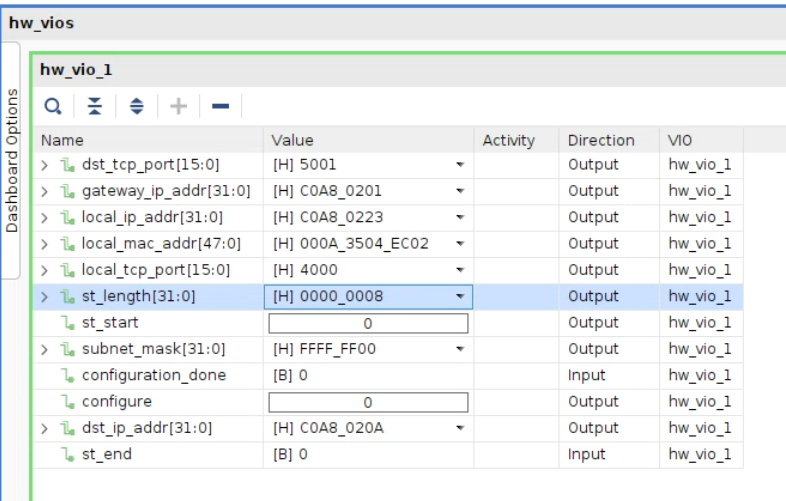
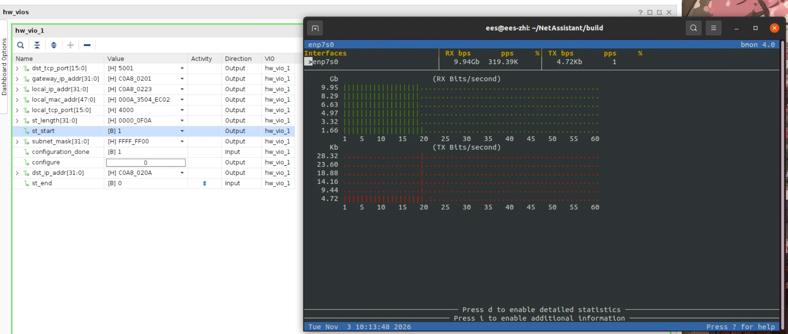
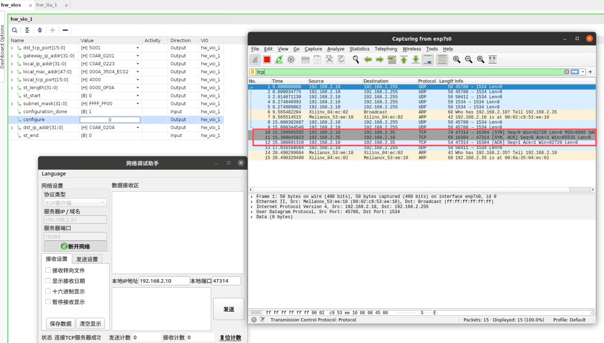
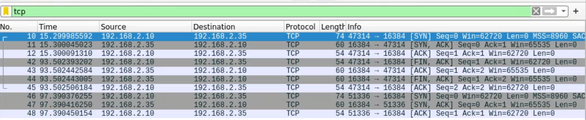
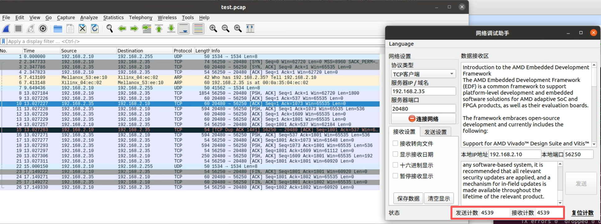

# 🎣 10Gbps TCP & UDP  FPGA network stack

## :rocket: UDP协议栈功能特点

| 根据 OSI 分层模型实现符合 **IEEE802.3** 标准的 **ARP、IPV4、ICMP、UDP** 协议栈 |
| ------------------------------------------------------------ |
| 支持 ARP，用于获取或发送 MAC 地址                            |
| 支持 ICMP，用于响应 Ping 命令                                |
| ARP 报文应答支持所有来查询的应答，可以缓存 1 个 ARP 表       |
| ARP 表未建立时，不会发送 UDP 数据包                          |
| 10Gbps 以太网连接，支持 UDP/IP 校验和处理，CRC 由 MAC IP 计算产生 |
| 用户接口为 **AXI4 stream** 接口，协议栈利用 MAC IP 产生的时钟 156.25MHz，10Gbps 数据总线宽度 64bit |


## :rocket: UDP协议栈验证

### :hammer: Build

1. 从github处下载对应的仓库代码

   ```cmd
   git clone git@github.com:Salefine/fpga_net_stack.git
   
   cd fpga_net_stack
   ```

2. Windows 环境使用 `scripts\build.bat` 集成入口：运行后列出所有开发板（如 `Alveo_U200`、`xcvu5p`），选择后直接在对应的 `example\<开发板>\fpga` 目录下创建/打开 Vivado 工程。工程创建脚本已集成在 `scripts\build.bat` 内（网络协议栈 RTL 列表共享，开发板器件型号在脚本内 `:board_cfg` 板卡表中配置；尚未实现的开发板会在菜单中标注 `[not implemented yet]`）。Vivado 安装路径通过环境变量 `VIVADO_2024_2` 指定，或修改脚本内的默认路径。

   ```cmd
   cd scripts
   ./build.bat
   ```

   也可以跳过菜单，直接指定开发板与目标：

   ```cmd
   ./build.bat xcvu5p
   ./build.bat xcvu5p fpga
   ./build.bat xcvu5p clean
   ./build.bat list
   ```

   - `./build.bat xcvu5p` — 打开 xcvu5p 工程（默认目标 `open`，启动 Vivado GUI，工程不存在时先创建）
   - `./build.bat xcvu5p fpga` — 创建/恢复 xcvu5p 的 Vivado 工程
   - `./build.bat xcvu5p clean` — 清除 xcvu5p 生成的工程文件
   - `./build.bat list` — 列出所有开发板

3. Linux 环境使用开发板目录下的 Makefile（Vivado 路径在 Makefile 顶部的 `VIVADO_SETTINGS` 中修改）：

   ```bash
   cd example/xcvu5p/fpga
   make fpga    # 创建/恢复工程
   make         # 打开 Vivado GUI
   make clean   # 清除生成的文件
   ```

   代码中关于协议栈的选择，选择UDP/TCP就将其置1。

   ```verilog
   localparam UDP = 0;
   localparam TCP = 1;
   localparam AMD = 0;
   ```

   


### :unicorn: UDP速率测试

1.配置好FPGA的mac地址以及ip地址。同时配置好目的ip。这里




同时在linux的主机端上配置好主机的ip

```cmd
enp7s0: flags=4163<UP,BROADCAST,RUNNING,MULTICAST>  mtu 1500
        inet 192.168.2.10  netmask 255.255.255.0  broadcast 192.168.2.255
        ether 00:02:c9:53:ee:10  txqueuelen 1000  (Ethernet)
        RX packets 72215  bytes 12274248 (12.2 MB)
        RX errors 0  dropped 0  overruns 0  frame 0
        TX packets 34  bytes 2430 (2.4 KB)
        TX errors 0  dropped 0 overruns 0  carrier 0  collisions 0
```

首先是测试arping功能，验证arp的发送与响应

```cmd
ees@ees-zhi:~/NetAssistant/build$ sudo arping 192.168.2.35
ARPING 192.168.2.35
60 bytes from 00:0a:35:04:ec:02 (192.168.2.35): index=0 time=75.952 usec
60 bytes from 00:0a:35:04:ec:02 (192.168.2.35): index=1 time=82.335 usec
60 bytes from 00:0a:35:04:ec:02 (192.168.2.35): index=2 time=61.546 usec
60 bytes from 00:0a:35:04:ec:02 (192.168.2.35): index=3 time=84.388 usec
60 bytes from 00:0a:35:04:ec:02 (192.168.2.35): index=4 time=27.712 usec
60 bytes from 00:0a:35:04:ec:02 (192.168.2.35): index=5 time=86.542 usec
^C
--- 192.168.2.35 statistics ---
6 packets transmitted, 6 packets received,   0% unanswered (0 extra)
rtt min/avg/max/std-dev = 0.028/0.070/0.087/0.021 ms
```

验证ping功能

```cmd
ees@ees-zhi:~/NetAssistant/build$ ping 192.168.2.35
PING 192.168.2.35 (192.168.2.35) 56(84) bytes of data.
64 bytes from 192.168.2.35: icmp_seq=1 ttl=255 time=0.069 ms
64 bytes from 192.168.2.35: icmp_seq=2 ttl=255 time=0.069 ms
64 bytes from 192.168.2.35: icmp_seq=3 ttl=255 time=0.074 ms
64 bytes from 192.168.2.35: icmp_seq=4 ttl=255 time=0.062 ms
64 bytes from 192.168.2.35: icmp_seq=5 ttl=255 time=0.253 ms
^C
--- 192.168.2.35 ping statistics ---
5 packets transmitted, 5 received, 0% packet loss, time 4100ms
rtt min/avg/max/mdev = 0.062/0.105/0.253/0.073 ms

```


验证协议栈速率，这里让FPGA一直在发包，让FPGA一直向主机发送数据包，这里网卡的负载能力有限，所以数据包的长度超过4500字节时网卡会收不到数据包。

```cmd
ees@ees-zhi: sudo ip link set enp7s0 mtu 9000
ees@ees-zhi: sudo bmon -bp enp7s0
```




## :rocket: TCP协议栈

| 根据 OSI 分层模型实现符合 **IEEE802.3** 标准的 **ARP、IPV4、ICMP、TCP** 协议栈 |
| ------------------------------------------------------------ |
| 支持 ARP，用于获取或发送 MAC 地址                            |
| 支持 ICMP，用于响应 Ping 命令                                |
| 作为 TCP server，响应 client 的建联请求、断联请求，也可主动发起断联请求 |
| ARP 报文应答支持所有来查询的应答，只维护 1 个业务所用的 ARP 表 |
| ARP 表未建立时，不响应建联请求                               |
| ARP 表已建立时，接受到配置的 TCP 监听请求后才会响应建联请求  |
| 10Gbps 以太网连接，支持 TCP/IP 校验和处理，CRC 由 MAC IP 计算产生 |
| 基于 **AMD/Xilinx 10G MAC IP** 开发，MTU 支持 9000Bytes ~ 64Bytes 数据传输 |
| 用户接口为 **AXI4 stream** 接口，协议栈利用以太网 MAC IP 产生的时钟 156.25MHz，10Gbps 数据总线宽度 64bit |
| TCP/IP 协议栈 IP core 内部数据为 8 Bytes 对齐处理            |
| TCP 数据报文的发送、接收、应答                               |
| TCP 建联后，接收到客户端RST报文时，直接断开连接              |


###  :factory: 分层与数据通路

TCP 协议栈采用流式分层结构：`tcp_stack_top.v` 负责网络配置、ARP 解析以及 Ethernet/IPv4 协议分流；`tcp_layer.v` 将 TCP 连接控制、接收和发送模块组合起来。数据通路以 64-bit AXI-Stream 传递，使用 `tkeep` 标识有效字节、`tlast` 标识报文边界，并通过 `tvalid/tready` 实现背压。

- **接收方向**：`eth_axis_rx_v1` 去除 Ethernet 头并按 EtherType 分流；`ip_rx` 解析并去除 IPv4 头，再按 IP Protocol 将 TCP（`6`）和 ICMP（`1`）分开。TCP 数据由 `tcp_rx` 解析、校验、对齐后送往应用侧。
- **TCP 控制**：`tcp_rx` 将 SYN、ACK、FIN 和数据段相关事件及序号信息交给 `tcp_ctrl`。`tcp_ctrl` 维护连接状态、服务器序号和确认号，并生成 SYN+ACK、ACK、FIN+ACK 等控制段。
- **发送方向**：`tcp_tx` 接收应用 AXI-Stream 数据，缓存负载并计算 TCP 校验和；`tcp_layer` 在控制段和数据段之间进行帧级仲裁，控制段优先，选定的来源保持到当前帧 `tlast` 握手，避免不同报文拼接。
- **网络封装**：TCP/ICMP 流经 IP 协议流仲裁后进入 `ip_tx`；IPv4 帧再与 ARP 报文仲裁，最后由 `eth_axis_tx_v1` 添加 Ethernet 头并输出到 MAC。Ethernet FCS/CRC 由外部 MAC IP 处理。
- **配置与 ARP**：配置接口触发对端 IP 的 ARP 查询。成功解析后保存对端 MAC 并置位 `configuration_done`；若解析失败，`configuration_done` 不会置位。


###  :fireworks:TCP协议栈验证

1.验证三次握手与四次挥手

打开网络调试工具。配置好本地端口以及ip，在FPGA端配置好端口以及ip。这里TCP的port在握手后需要重新学习。



在连接之后，本地端口会从20481便化成47314。每次握手成功，本地端口都会变化。

三次握手与四次挥手报文：




多段存储，TCP在发包时，会将长的数据包进行分割，假设发送一个1500字节的数据包，那么主机端会将数据分割成三段。

1. 这些数据包使用wireshark难以获取，需要使用***tcpdump***命令来获取


```cmd
ees@ees-zhi: sudo tcpdump -i enp7s0 -nn -s 0 -w test.pcap
```

###  :fireworks: TCP协议栈发包

 构建一个echo的回环，从client发送数据到server接收数据并且将数据转发给client，查看tcp的发送计数以及接收计数是否一致。




代码参考：

```http
https://github.com/alexforencich/verilog-ethernet
```


## :end: 时序性能

### :alien: 优化结果

| 时钟域                                                 | 优化前 WNS | 优化后 WNS  | 说明                          |
| ------------------------------------------------------ | ---------- | ----------- | ----------------------------- |
| **clk_156mhz_int**（156.25MHz，TCP/IP 栈全部用户逻辑） | 1.499      | **2.239** ✓ | 达到 2.0 目标，提升 0.74ns    |
| sfp0_rx_clk_int                                        | 2.722      | 3.624       |                               |
| 整体设计                                               | 1.499      | 1.935       | 受 GT IP 内部路径限制（见下） |

时序全部满足，bitstream 已生成（`fpga.runs/impl_1/fpga.bit`），0 未布线网络。

### :alembic: 优化内容

1. **`tcp_stack_top.v`** — ip→tcp 解复用后插入一级寄存切片，切断「ip_type 译码 → tcp_rx」组合路径的头部；`tcp_paylen`/`recv_*_ip_addr` 元数据在同一使能下延迟一拍与 AXIS 对齐（处理了寄存级保持未消费拍的配对问题）
2. **`tcp_rx.v`** — 原 13 级逻辑的关键路径（ip_type → 对齐拼接 → payload FIFO BRAM 写口）重构为：
   - stage-1：随拍锁存新负载字节/字节数/tlast（组合深度只剩裁剪+计数）
   - stage-2：桶形移位+按位或拼接（替代逐字节动态索引比较，消除了综合出的 CARRY8 链），输出经 FIFO 输入寄存级写入 xpm FIFO
   - s2 的 `cur_tlast` 比较链改为高位预译码（与原逻辑严格等价）
3. **`tcp_tx.v`** — `cks_s4` 中两级 `checksum_gen` 级联拆成两拍（新增 `cks_s5` 状态），消除 tcp_tx 的关键路径

### :book: 整体 1.935ns 的说明

唯一低于 2.0 的路径在 **GT 向导 IP 内部**（powergood 延迟计数器，322MHz `txoutclkpcs` PCS 时钟域）：0 级逻辑、纯布线（同 slice 内 1.06ns 布线）。该路径**原设计就是 1.848**，一直低于 2.0，与本次改动无关。

fabric 逻辑新的临界路径在 ARP 模块（2.239ns），若后续还想再提升可以继续优化那里。


