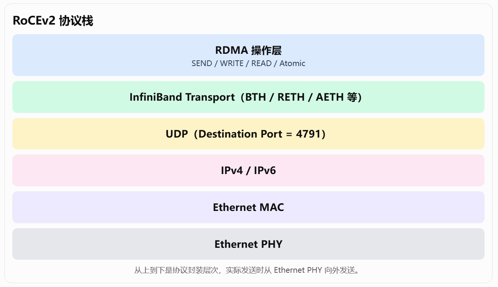
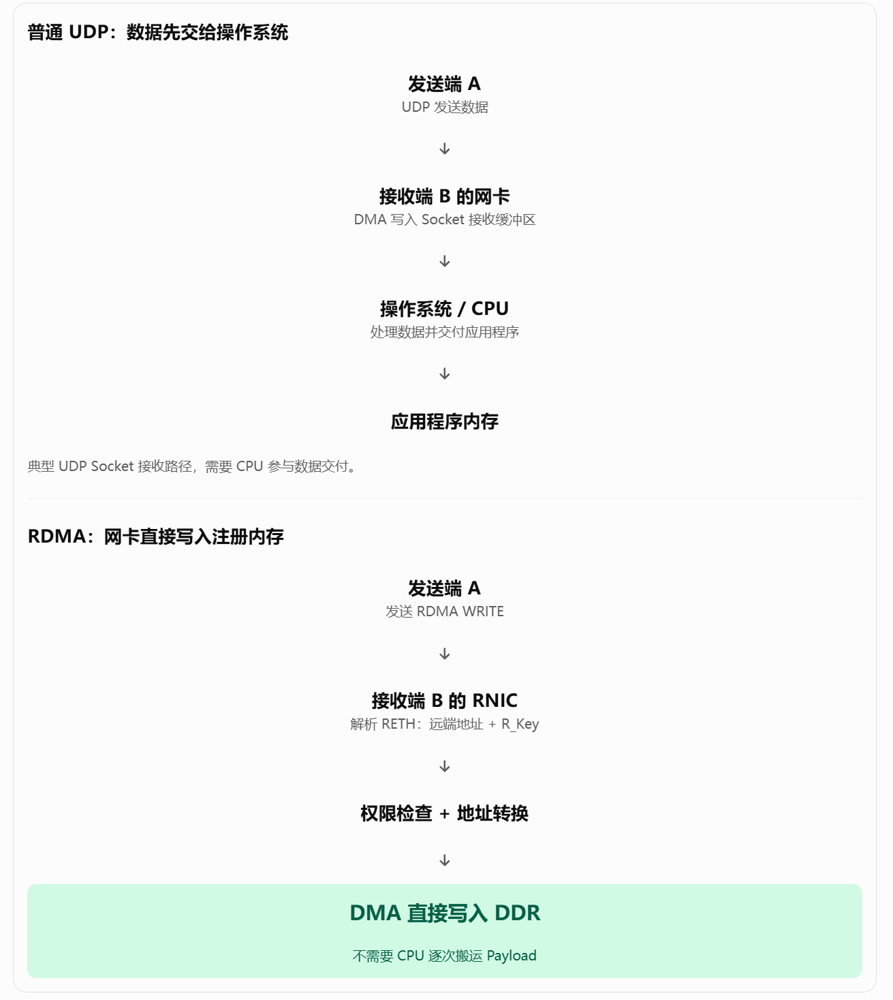
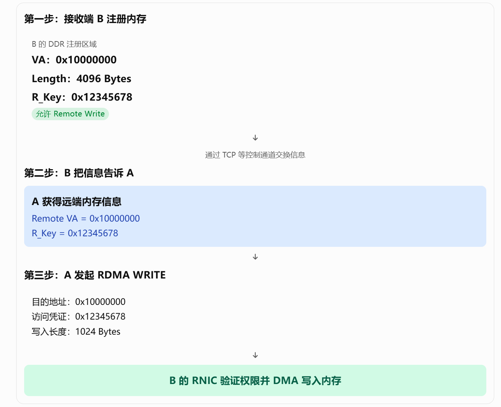
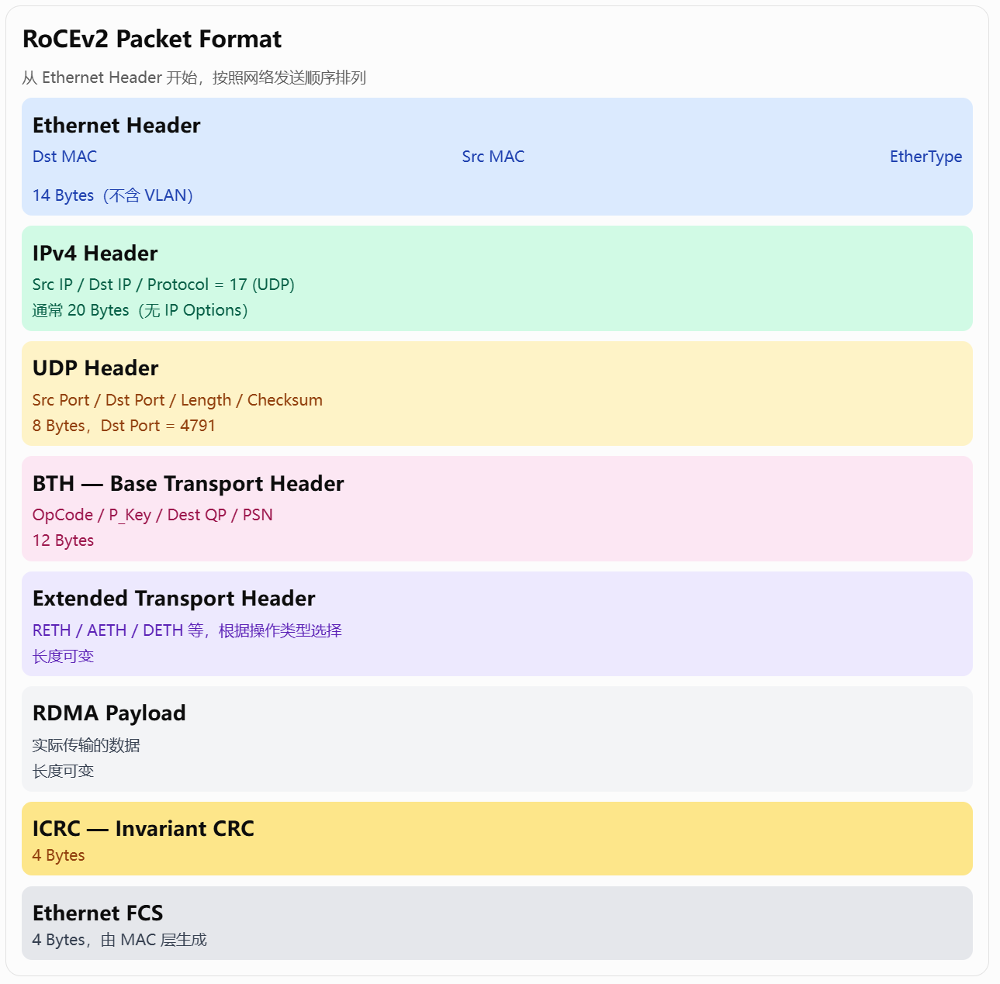
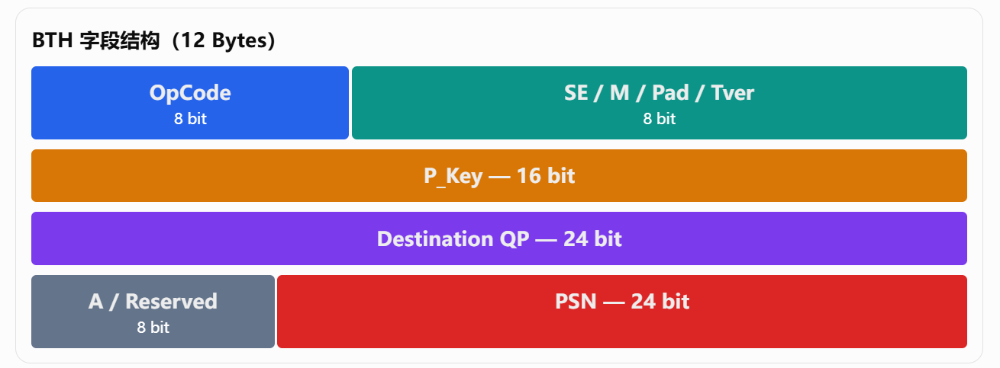
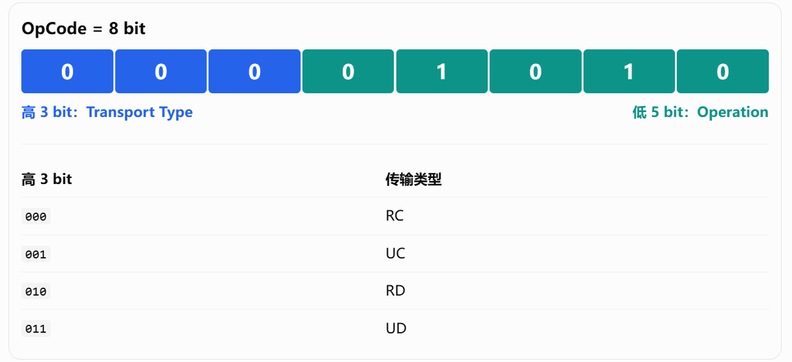
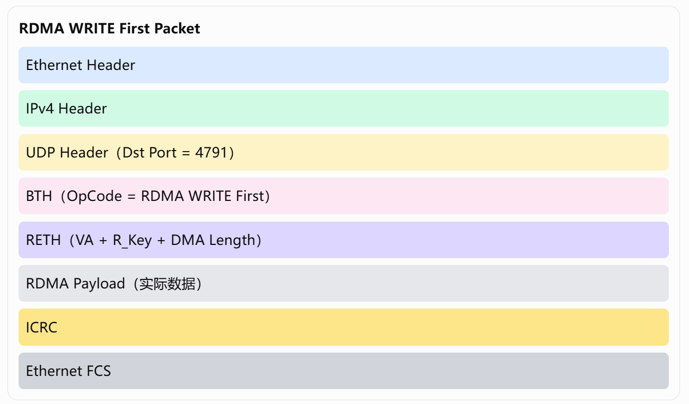
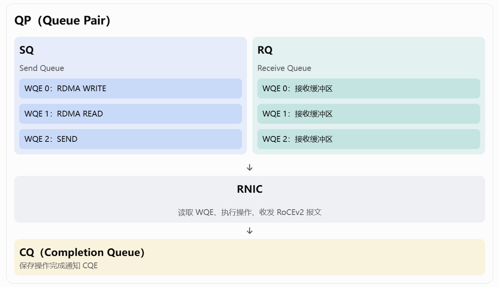

# Remote Direct Memory Access (RDMA)

RoCEv2（RDMA over Converged Ethernet v2）是在 UDP/IP 网络之上承载 InfiniBand RDMA 传输层协议的技术。



如果从 FPGA 硬件解析和封包实现的角度来看，可以把 RoCEv2 数据包分成以下几层：

1. Ethernet Header：以太网帧头。

2. IP Header：IPv4 或 IPv6 头。

3. UDP Header：UDP 头，目的端口通常为 `4791`。

4. BTH：Base Transport Header，RoCEv2 的基本传输层头。

5. Extended Headers：扩展头，根据操作类型决定是否存在。

6. Payload：数据负载。

7. ICRC：Invariant CRC，RoCEv2 使用的传输完整性校验字段。

   

## RDMA Stack vs UDP/TCP

RDMA 能够直接操作远端内存，关键不在于 UDP 变得更强大了，而在于 RDMA 在普通网络传输之外，增加了一套专门的内存管理、访问授权和 DMA 操作机制。核心原因：**内存注册 + 访问授权 + DMA 传输。**

### **UDP vs RDMA**



### **RDMA 如何获取写地址**

关键在于提前注册内存，并交换远端访问信息。



### **核心概念**

| 概念                | 作用                                    |
| ------------------- | --------------------------------------- |
| Memory Registration | 注册并锁定允许 RDMA 访问的内存          |
| R_Key               | 验证远端内存访问权限                    |
| DMA                 | 不经过 CPU 搬运，将数据直接写入目标内存 |

### **结论**

RDMA 的本质
1. B 提前注册内存。
2. B 将远端虚拟地址 VA 和 R_Key 告诉 A。
3. A 通过 RDMA WRITE / READ 发起操作。
4. B 的 RNIC 验证访问权限。
5. RNIC 通过 DMA 直接操作 B 的注册内存。
注意：RDMA 不是可以随意访问对方整个 DDR，而是只能访问已注册且授权的内存区域。


##  RDMA协议格式

一个典型的 RoCEv2 IPv4 数据包可以表示为：



> 1. UDP Payload 并不是直接存放用户数据，而是先放 InfiniBand Transport Header，再放 RDMA 数据。
> 2. ICRC 和 Ethernet FCS 是两个不同的 CRC。ICRC 属于 RDMA 数据包，FCS 属于 Ethernet 帧。
> 3. 其中UDP Destination Port = 4791即0x12b7，表示 RoCEv2。

UDP 后面的内容才是 RoCEv2 真正需要重点研究的部分。它主要由以下几类 Header 组成：

| Header | 长度     | 作用                                            |
| ------ | -------- | ----------------------------------------------- |
| BTH    | 12 Bytes | 基础传输头，所有标准 RDMA Transport Packet 都有 |
| RETH   | 16 Bytes | RDMA WRITE / READ 使用的远端内存信息            |
| AETH   | 4 Bytes  | ACK、NAK 等应答信息                             |
| DETH   | 8 Bytes  | UD 模式使用                                     |
| ICRC   | 4 Bytes  | RDMA 包完整性校验                               |

注意：这些扩展头并不是每个包都存在，具体取决于操作类型和 OpCode。

### **BTH：基础传输头**

BTH（Base Transport Header）固定为 12 Bytes。



| 字段           | 位宽   | 说明                     |
| -------------- | ------ | ------------------------ |
| OpCode         | 8 bit  | 指示 RDMA 操作类型       |
| SE             | 1 bit  | Solicited Event          |
| M              | 1 bit  | Migration Request        |
| Pad Count      | 2 bit  | 填充字节数               |
| Tver           | 4 bit  | Transport Header Version |
| P_Key          | 16 bit | Partition Key            |
| Destination QP | 24 bit | 目标 Queue Pair 编号     |
| A              | 1 bit  | ACK Request              |
| Reserved       | 7 bit  | 保留位                   |
| PSN            | 24 bit | Packet Sequence Number   |

这里需要重点关注三个字段：

- **OpCode**：告诉接收端当前数据包执行什么 RDMA 操作。
- **Destination QP**：告诉接收端应该交给哪个 QP 处理。
- **PSN**：用于数据包顺序管理、确认和重传。

opcode划分



```verilog
// RC SEND
localparam [7:0] RC_SEND_ONLY       = 8'h04;

// RC RDMA WRITE
localparam [7:0] RC_WRITE_FIRST     = 8'h06;
localparam [7:0] RC_WRITE_MIDDLE    = 8'h07;
localparam [7:0] RC_WRITE_LAST      = 8'h08;
localparam [7:0] RC_WRITE_ONLY      = 8'h0A;

// RC RDMA READ
localparam [7:0] RC_READ_REQUEST    = 8'h0C;
localparam [7:0] RC_READ_RESP_FIRST = 8'h0D;
localparam [7:0] RC_READ_RESP_MID   = 8'h0E;
localparam [7:0] RC_READ_RESP_LAST  = 8'h0F;
localparam [7:0] RC_READ_RESP_ONLY  = 8'h10;

// RC ACK
localparam [7:0] RC_ACK             = 8'h11;
```

| OpCode            | 十六进制 | 含义                              |
| ----------------- | -------- | --------------------------------- |
| RDMA WRITE FIRST  | `0x06`   | 分段传输的第一个数据包            |
| RDMA WRITE MIDDLE | `0x07`   | 分段传输的中间数据包              |
| RDMA WRITE LAST   | `0x08`   | 分段传输的最后一个数据包          |
| RDMA WRITE ONLY   | `0x0A`   | 整个 WRITE 操作只用一个数据包完成 |


### **RETH：远端内存操作头**

RETH（RDMA Extended Transport Header）长度为 16 Bytes。

它主要用于 RDMA READ 和 RDMA WRITE 操作。

| 字段            | 长度   | 作用               |
| --------------- | ------ | ------------------ |
| Virtual Address | 64 bit | 远端内存虚拟地址   |
| R_Key           | 32 bit | 远端内存访问密钥   |
| DMA Length      | 32 bit | 本次操作的数据长度 |

### **AETH：应答头**

AETH（ACK Extended Transport Header）长度为 4 Bytes，主要用于 RC（Reliable Connected）模式。

它包含：

| 字段                    | 位宽   | 作用                   |
| ----------------------- | ------ | ---------------------- |
| Syndrome                | 8 bit  | 表示 ACK、NAK 类型     |
| Message Sequence Number | 24 bit | 应答关联的消息序列信息 |

### **RDMA 数据包对应关系**

RoCEv2 并不是只有一种固定的数据包格式，而是通过 BTH 中的 OpCode 区分不同操作。

先看最常见的 RC 模式：

| RDMA 操作  | 发送端使用的 Header  | 接收端反馈         |
| ---------- | -------------------- | ------------------ |
| SEND       | BTH + Payload        | ACK                |
| RDMA WRITE | BTH + RETH + Payload | ACK                |
| RDMA READ  | BTH + RETH           | 返回 READ Response |
| Atomic     | BTH + Atomic ETH     | 返回 Atomic ACK    |

例如，RDMA WRITE 的数据包：




## QP

**QP 是 RDMA 通信的核心端点。应用程序把要执行的操作提交给 QP，RNIC 从队列中取出操作并执行，最后通过 CQ 通知应用程序操作结果。**

QP 全称 Queue Pair，翻译为队列对。它由两个队列组成：

- SQ（Send Queue）：发送队列
- RQ（Receive Queue）：接收队列



> SQ 和 RQ 里面存放的并不是实际的数据 Payload，而是描述操作的工作队列项（WQE）。WQE 通常包含操作类型、内存地址、长度、Key 等信息。实际数据存放在注册过的内存缓冲区中。


