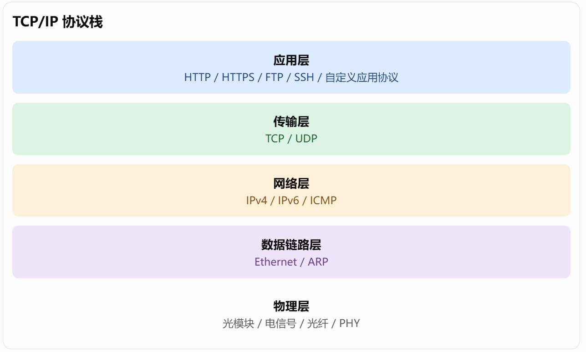
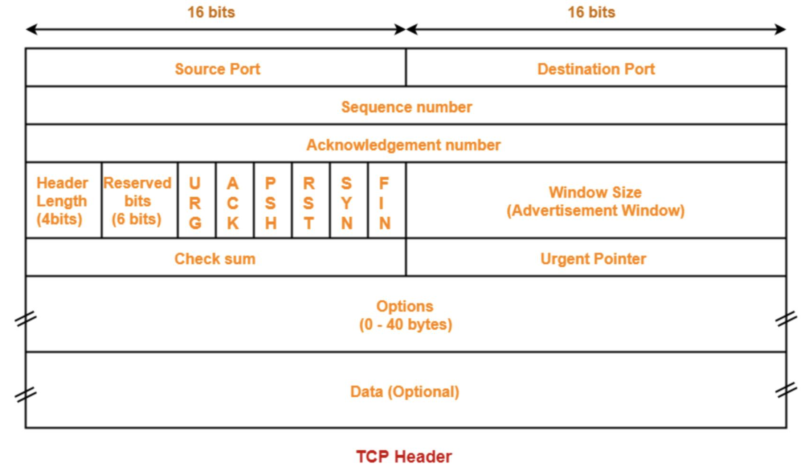
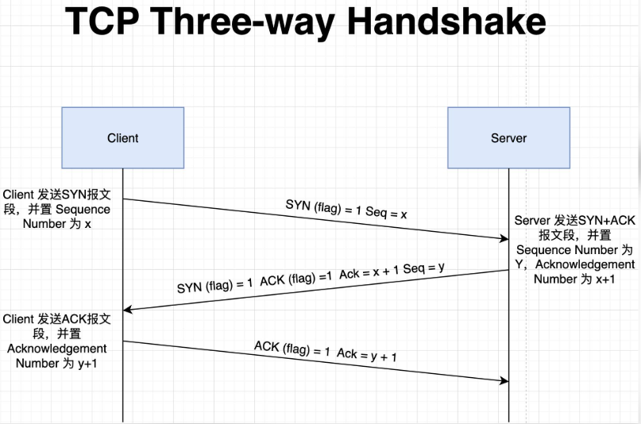
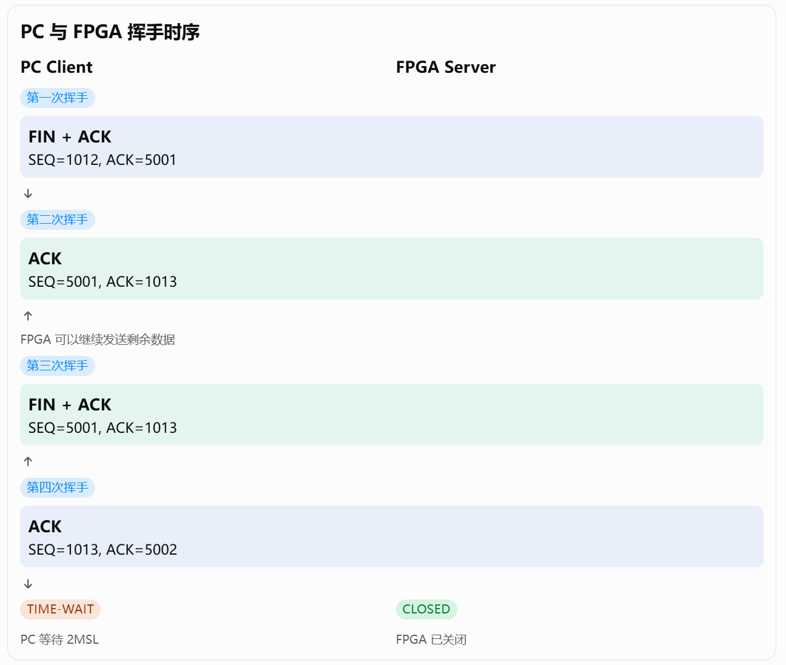
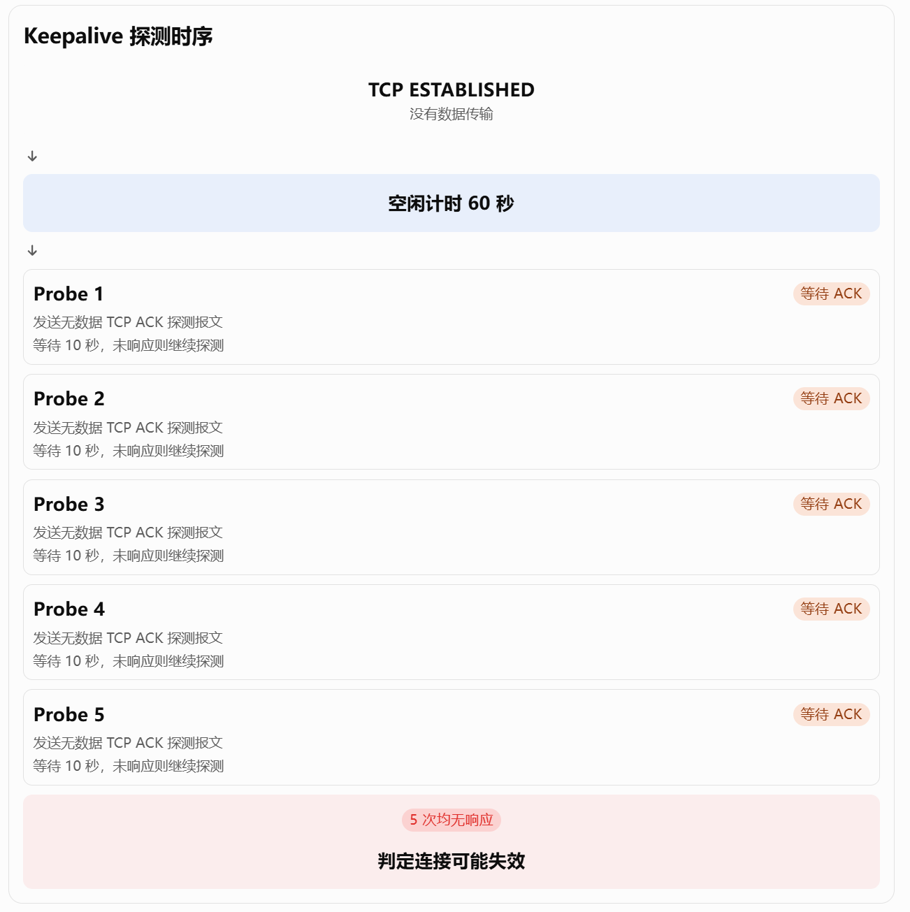
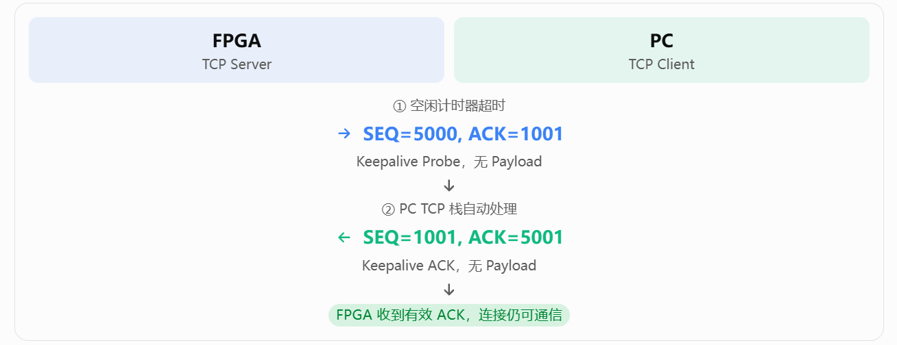

# <span style="color:green">Transmission Control Protocol</span>

TCP 属于传输层，位于 IP 层之上、应用层之下。



TCP（Transmission Control Protocol，传输控制协议）是 TCP/IP 协议栈中的核心传输层协议。它主要解决一个问题：

**如何在不可靠的 IP 网络上，为两个应用程序提供可靠、有序、双向的数据传输？**

## 1.报文格式

TCP 报文（TCP Segment）由两部分组成：

- TCP Header：TCP 首部。
- TCP Payload：TCP 携带的应用层数据。



TCP 基本首部长度为 20 字节，包含以下字段：

| 字段                  | 长度   | 作用         |
| --------------------- | ------ | ------------ |
| Source Port           | 16 bit | 源端口       |
| Destination Port      | 16 bit | 目的端口     |
| Sequence Number       | 32 bit | 序列号       |
| Acknowledgment Number | 32 bit | 确认号       |
| Data Offset           | 4 bit  | TCP 首部长度 |
| Reserved              | 3 bit  | 保留位       |
| Flags                 | 9 bit  | 控制标志     |
| Window                | 16 bit | 接收窗口     |
| Checksum              | 16 bit | TCP 校验和   |
| Urgent Pointer        | 16 bit | 紧急指针     |
| Options               | 可变   | TCP 选项     |
| Payload               | 可变   | 应用层数据   |

其中，最重要的字段是：

**Sequence Number、Acknowledgment Number、Flags、Window、Checksum。**

### **1.1 Sequence Number（序列号）**

TCP 是面向字节流的协议。

假设 PC 要发送：

```tex
hello,world
```

一共 11 个字节。

假设初始序列号 ISN = 1000，那么数据对应的序列号范围为：

```tex
h       -> 1000
e       -> 1001
l       -> 1002
l       -> 1003
o       -> 1004
,       -> 1005
w       -> 1006
o       -> 1007
r       -> 1008
l       -> 1009
d       -> 1010
```

发送完毕后，下一字节的序列号是：

\[ 1000+11=1011 \]

所以，序列号表示的是 TCP 字节流中的位置，而不是 TCP 报文的编号。

### **1.2 Acknowledgment Number（确认号）**

确认号表示：**接收方期望发送方下一次发送的字节序列号。**

例如：

PC 发送：

```
SEQ = 1000
LEN = 11
```

FPGA 接收成功后返回：

```
ACK = 1011
```

因为：

\[ ACK=SEQ+LEN \]

> - 如果收到的数据中包含 SYN，SYN 消耗一个序列号。
> - 如果收到的数据中包含 FIN，FIN 也消耗一个序列号。
> - 单纯 ACK 不消耗序列号。
> - 如果存在乱序或者丢包，ACK 不一定等于当前报文的 SEQ + LEN，而是累计确认接收到的连续字节范围。

例如，接收方收到了 1000～1009，但是没有收到 1010，那么 ACK 仍然是 1010。

### **1.3 TCP Flags（控制标志位）**

TCP 的控制标志用于管理连接状态和数据传输。

| 标志 | 含义                      | 作用                     |
| ---- | ------------------------- | ------------------------ |
| SYN  | Synchronize               | 建立连接、同步初始序列号 |
| ACK  | Acknowledgment            | 确认报文                 |
| FIN  | Finish                    | 主动关闭连接             |
| RST  | Reset                     | 强制复位连接             |
| PSH  | Push                      | 提示尽快将数据交付应用层 |
| URG  | Urgent                    | 紧急数据指示             |
| ECE  | ECN Echo                  | 拥塞通知                 |
| CWR  | Congestion Window Reduced | 拥塞窗口已降低           |
| NS   | Nonce Sum                 | 历史扩展用途             |

其中 FPGA 实现 TCP 时，最需要关注的是：

`SYN、ACK、FIN、RST、PSH`。

### **1.4 Window（接收窗口）**

Window 表示接收方当前愿意接收多少 TCP 数据。

例如：

```
Window = 4096
```

意味着接收方通告了 4096 字节的接收窗口（还需要考虑 Window Scale 选项是否启用）。

发送方不能超过接收方允许的窗口范围发送未确认数据。

这个机制叫做**流量控制**。

### **1.5 Checksum（校验和）**

TCP Checksum 用于检测 TCP 报文传输过程中的数据错误。

它并不是只对 TCP Header 计算，而是覆盖：

- IP 伪首部（Pseudo Header）。
- TCP Header。
- TCP Payload。

IP 伪首部包含源 IP、目的 IP、协议号和 TCP 长度等信息。

> TCP 校验和使用 16 位反码求和算法，接收端也需要进行校验。


## 2.**TCP 三次握手：建立连接**

三次握手的目的是：建立 TCP 连接，让通信双方确认彼此的收发能力，并同步初始序列号。




## **3.TCP 四次挥手**

TCP 是全双工通信协议。

这意味着 PC 和 FPGA 的发送方向是相互独立的。

例如：

- PC 可以向 FPGA 发送数据。
- FPGA 也可以向 PC 发送数据。

所以关闭连接时，双方需要分别关闭自己的发送方向。



## 4.**TCP Keepalive**

假设 PC 和 FPGA 已经建立 TCP 连接。

```
PC                         FPGA
 |                           |
 |-------- TCP连接建立 ------|
 |                           |
 |       长时间没有数据       |
 |                           |
```

如果 PC 突然断电，FPGA 不一定能立即知道。

因为 TCP 是一个可靠传输协议，但它不会在没有数据传输时，自动持续检测对端是否存活。

TCP Keepalive 就是为了解决这个问题。

它的工作方式是：

1. 连接空闲达到指定时间。
2. TCP 发送方发送 Keepalive Probe。
3. 对端 TCP 协议栈收到后返回 ACK。
4. 发送方收到 ACK，认为对端 TCP 协议栈仍然可达。
5. 如果连续多次探测没有得到响应，则认为连接可能失效。

> Keepalive 是一种可选机制，不是 TCP 连接建立后必然自动运行的功能。



FPGA 构造一个 TCP 包发给 PC：

**FPGA → PC**

Keepalive Probe

| TCP 字段         | 值             |
| ---------------- | -------------- |
| Source IP        | `192.168.1.23` |
| Source Port      | `0x5001`       |
| Destination IP   | `192.168.1.56` |
| Destination Port | `0x1001`       |
| SEQ              | **5000**       |
| ACK              | **1001**       |
| ACK Flag         | 1              |
| SYN / FIN / RST  | 0              |
| TCP Payload      | 0 字节         |

> SEQ = SND.NXT - 1 = 5001 - 1 = 5000。

**PC → FPGA**

Keepalive ACK

| TCP 字段         | 值             |
| ---------------- | -------------- |
| Source IP        | `192.168.1.56` |
| Source Port      | `0x1001`       |
| Destination IP   | `192.168.1.23` |
| Destination Port | `0x5001`       |
| SEQ              | **1001**       |
| ACK              | **5001**       |
| ACK Flag         | 1              |
| SYN / FIN / RST  | 0              |
| TCP Payload      | 0 字节         |

> ACK=5001，表示 PC 当前仍然期望 FPGA 从序列号 5001 开始发送数据。


